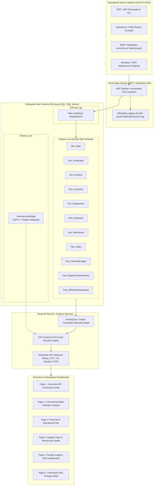
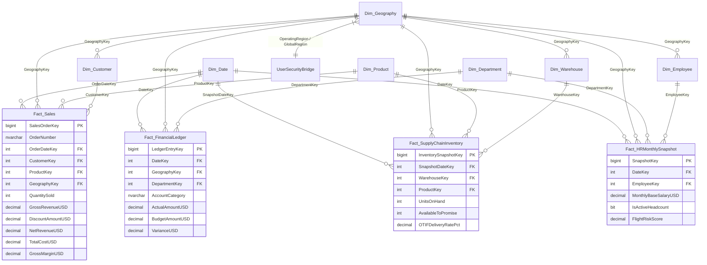

# Enterprise Business Intelligence Suite: Architecture & Design

## 1. Executive Summary
The **Enterprise Business Intelligence Suite** is a unified analytics platform engineered for a multi-national enterprise operating across **Americas (North America & LATAM)**, **EMEA (Western Europe)**, and **APAC (North & South)**. It breaks down enterprise data silos by integrating **Commercial Sales**, **Financial General Ledger**, **Supply Chain Logistics**, and **Human Resources** into a single Kimball-compliant Dimensional Data Warehouse with Row-Level Security (RLS).

---

## 2. High-Level System Architecture

---

## 3. Conformed Star Schema (Entity-Relationship Diagram)

---

## 4. Multi-Region Security Architecture (Dynamic RLS)
- **Token Extraction**: When a report loads in Power BI Service or Teams embedded portals, the client security token supplies the user's `USERPRINCIPALNAME()`.
- **Dynamic Lookup**: The model filters `sec.UserSecurityBridge` where `UserPrincipalName = USERPRINCIPALNAME()`.
- **Inherited Filtering**: The resulting set of permissible regions cascades through `dw.Dim_Geography`. Because all fact tables (`Fact_Sales`, `Fact_FinancialLedger`, `Fact_SupplyChainInventory`, `Fact_HRMonthlySnapshot`) maintain foreign keys to `Dim_Geography`, the entire dashboard is instantly partitioned.
- **Fail-Safe Default**: If an unmapped user accesses the workspace, the bridge yields 0 matching rows, resulting in empty visualizations (safe default / zero data leakage).

---

## 5. Performance Optimization Strategy
1. **Star Schema vs Snowflaking**: Kept dimensions denormalized (e.g. Category and Subcategory merged in `Dim_Product`) to eliminate multi-hop joins during query evaluation.
2. **Columnar Storage & Compression**: Integer surrogate keys (`DateKey`, `ProductKey`, `GeographyKey`) maximize VertiPaq dictionary compression in Power BI.
3. **Persisted Computed Columns**: Formula columns like `GrossMarginUSD` and `AvailableToPromise` are computed and persisted in SQL Server to offload runtime CPU load from DAX.
4. **Partitioning**: Fact tables partitioned by Fiscal Year to accelerate rolling window refreshes.
